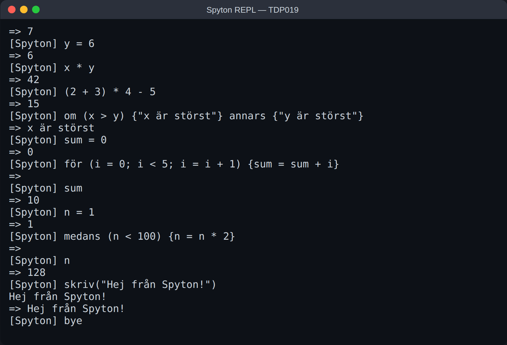
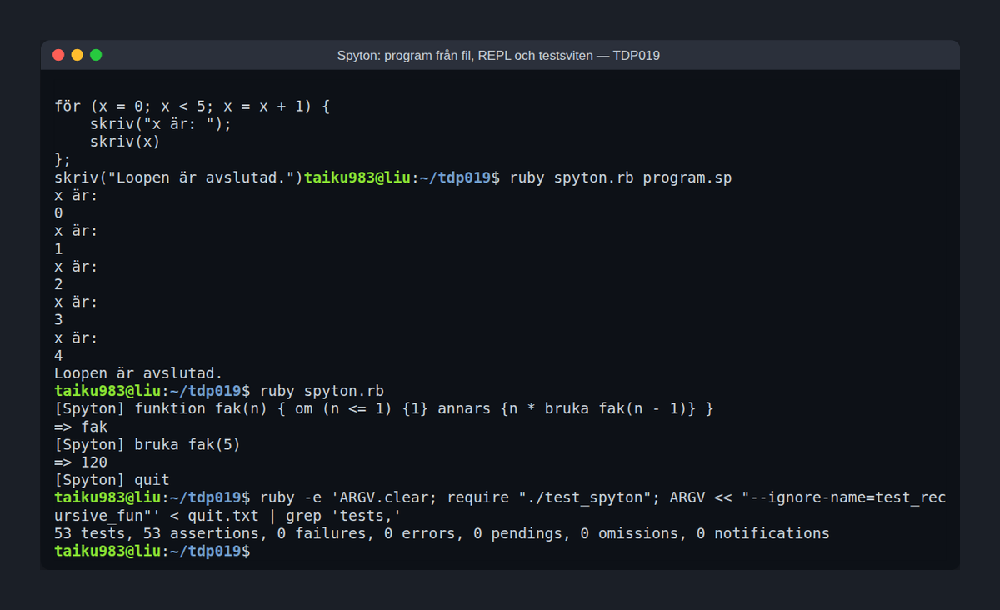

# Spyton

Spyton is a small programming language with Swedish keywords, with an interpreter written in Ruby. We designed and built it in a team of 3.



## The language

- Keywords like `skriv` (print), `om`/`annars` (if/else), `medans` (while), `för` (for), `funktion` (define a function) and `bruka` (call it)
- Variables, arithmetic, comparisons, conditionals, loops and recursive functions with return values
- Variable scope for functions and blocks

```
funktion factorial(n) {
  om (n <= 1) {1} annars {n * bruka factorial(n - 1)}
}
bruka factorial(5)
```

## How it is built

- `docs/grammar.bnf` – the grammar in BNF
- `parseclass.rb`, `ruleclass.rb` – a recursive descent parser
- `ast_nodes.rb` – the syntax tree; each node class evaluates itself
- `scope_class.rb` – variable scope
- `spyton.rb` – the language definition, the REPL and the file runner
- `test_spyton.rb` – 54 tests in Test::Unit



## Running it

Needs Ruby.

```bash
ruby spyton.rb              # REPL
ruby spyton.rb program.sp   # run a file
ruby test_spyton.rb         # tests
```

Built as a course project at Linköping University (TDP019).

More of my projects: https://tdp003-2024-taiku983.kubernetes-public.it.liu.se/
